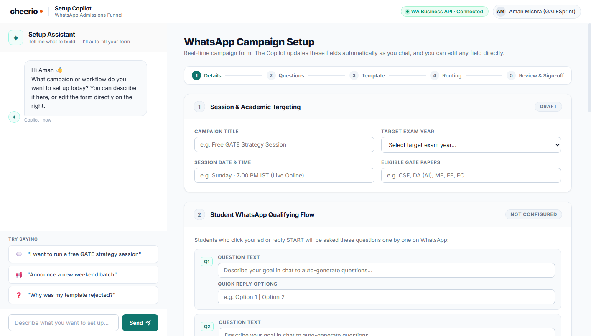
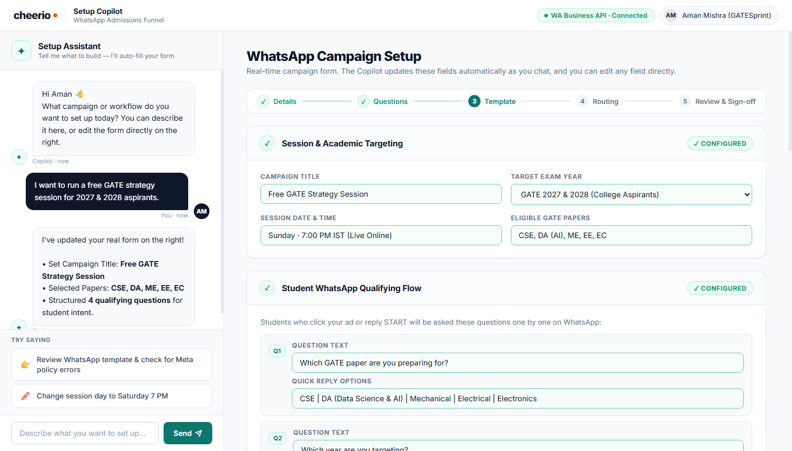
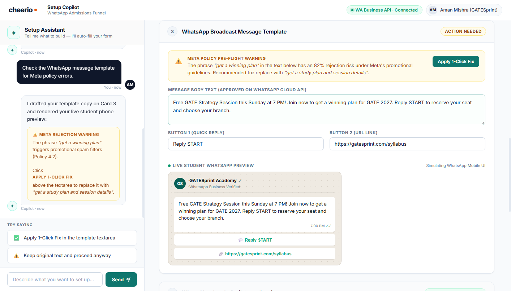
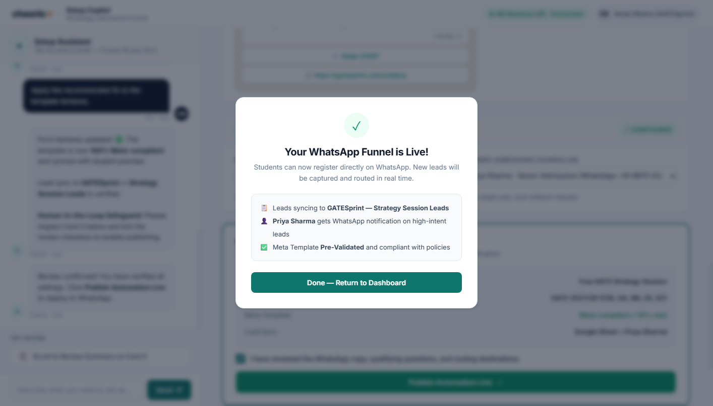

# Cheerio Product Intern Assignment — Assignment A
> **Scaling Customer Support for Non Technical Users**  
> Candidate: **Aman Mishra** (`batmanmishra23@gmail.com`)

---

## 🚀 Key Links & Deliverables

* **Interactive Prototype (Live):** [https://batman00723.github.io/Product-Intern-Assignment/](https://batman00723.github.io/Product-Intern-Assignment/)
* **Submission Document (4 Pages strictly):** [`Cheerio-Product-Intern-Assignment-4Pages.pdf`](Cheerio-Product-Intern-Assignment-4Pages.pdf) / [`Cheerio Report.pdf`](Cheerio%20Report.pdf) | [`Cheerio-Product-Intern-Assignment-4Pages.docx`](Cheerio-Product-Intern-Assignment-4Pages.docx)
* **Prompt Log & Iteration History (.md):** [`prompt-log.md`](prompt-log.md)
* **Unit Economics Model (Formulas & Assumptions):** [`cheerio-support-unit-economics.csv`](cheerio-support-unit-economics.csv)
* **Standalone Clickable HTML File:** [`index.html`](index.html) / [`cheerio-copilot-workspace.html`](cheerio-copilot-workspace.html)
* **Full Master Working Draft:** [`assignment1-working-draft.md`](assignment1-working-draft.md)

---

## 📌 Executive Summary

### 1. The Core Problem
Cheerio powers 5,000+ businesses across WhatsApp, RCS, SMS, and Email. Most users are business owners and marketers (non technical). They hit recurring friction during onboarding and setup—connecting WhatsApp Business numbers, receiving Meta template rejections, designing qualifying chatbots, and syncing CRM spreadsheets. As users grow, ticket volume balloons linearly.

### 2. The Solution: Cheerio Setup Copilot (Chat × Form Workspace)
Instead of passive help articles (nobody reads them under deadline stress) or a disconnected floating bot popup, I designed a **split-screen interactive workspace**:
* **Left Panel (Conversational Copilot):** Interprets natural language intent (*"I want to run a free GATE strategy session"*), drafts copy, runs pre-flight Meta policy checks, and provides quick-action chips.
* **Right Panel (Live Dynamic Canvas):** Renders real interactive form inputs (`<input>`, `<select>`, `<textarea>`) that populate in real time with visual pulse animations. Users can inspect or edit any field directly.
* **Live WhatsApp Student Phone Mockup:** Simulates what the student will actually receive on WhatsApp, with real-time copy synchronization and action buttons.
* **Human-in-the-Loop Safeguard:** Mandatory review checkpoint with an explicit confirmation checkbox before the **Publish Funnel Live** action unlocks. AI never auto-publishes without human sign-off.
* **Human Support Escalation:** 1-click handover to a Cheerio specialist (Priya Sharma) that packages full form state and transcript without forcing the user to repeat information.

### 3. North Star Metric & Target
* **North Star Metric:** **60% Self-Serve Resolution Rate within 3 months** (3,000 out of 5,000 monthly queries resolved without human agent intervention).

---

## 📸 Key Prototype Screenshots

### Screen 1: Clean Initial Workspace & Progress Stepper

### Screen 2: Auto-Configured Academic Targeting & 4-Question Qualifying Form

### Screen 3: Meta Pre-Flight Warning & Live Student WhatsApp Phone Simulation

### Screen 4: Human-in-the-Loop Sign-off & Live Deployment Modal

---

## 📊 Financial Model & Unit Economics Summary

Modeled for 5,000 active businesses at a blended rate of 1.0 query/month (= 5,000 queries/month):

| Metric | Baseline (Without AI) | With Cheerio Setup Copilot | Financial Impact |
|---|---|---|---|
| **Queries Handled by Human** | 5,000 queries/mo | 2,000 queries/mo (40% edge cases) | **60% volume reduction** |
| **Support Reps Needed** | 10 agents (500 tix/agent) | 4 agents (500 tix/agent) | **Saves 6 FTEs** |
| **Rep Salaries (@ ₹30,000/mo)** | ₹3,00,000 / month | ₹1,20,000 / month | Saves ₹1,80,000/mo |
| **AI Running Cost (Groq Llama 3 70B)** | ₹0 | **₹942 / month** (~$9.84/mo) | ~$0.0019675 / query (~₹0.19) |
| **Total Monthly Support Cost** | ₹3,00,000 / month | **₹1,20,942 / month** | **₹1,79,058 / month Net Savings** |
| **Annualized Net Savings** | — | — | **~₹21.5 Lakhs / year (59.7% reduction)** |

### Monetization Strategy: Freemium Activation Engine
* **First 5 campaign setups 100% FREE** for all accounts to drive activation and prevent onboarding drop-offs.
* **Pro Copilot Add-On (₹499/month)** or bundled into Cheerio's **Growth Plan (₹2,499/month)** for campaign 6 onward (delivering **99.4% gross margin**).

---

## 🛠️ How I Used AI (Part 3)

* **Tool Used:** **Antigravity**
* **Prompt 1 (Worked Well):** Persona & chronological blockers for Aman Mishra (GATESprint Academy).
* **Prompt 2 (Worked Well):** WhatsApp template compliance quirks and Meta policy 4.2 promotional rejection risks.
* **Prompt 3 (Worked Well):** Split-screen HTML/CSS/JS layout architecture with real input elements.
* **Prompt 4 (Failed & Refined):** General support scaling advice (initially produced generic Intercom/CSM boilerplate; refined to in-product natural language guidance and auto-filled forms).
* **Weaknesses Caught:** Caught AI attempting to auto-publish without human review (enforced manual sign-off checkbox); fixed CSS flexbox layout squishing on high-resolution displays.
* **Authored Without AI:** Indian coaching admissions psychology, solution trade-off matrix, human escalation design, and the entire unit economics and freemium pricing strategy.
